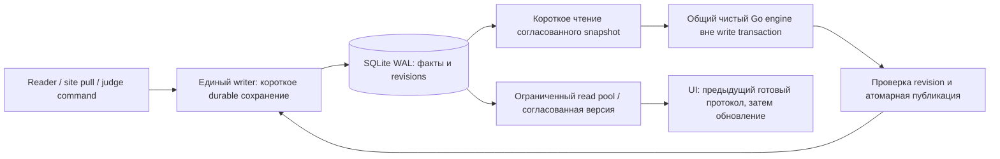

# Chrono Desk: задержки интерфейса во время события

Task: CHR-DESK-PERF-001
Docs-Impact: CROSS_PROJECT — диагностика и локальный кандидат общего snapshot engine; рабочее приложение не обновлено.
Дата: 2026-10-19. Исходная версия для воспроизведения: 0.6.12, f8ddc425713fa693b14cbc6e8dec6bbd2383267d.

## Вывод

Подтверждено ожидание единственного соединения с SQLite. Полный пересчёт держит
его в одной транзакции; HTTP-запросы интерфейса и сохранение поступивших отметок
ждут освобождения. Это воспроизведено на Mac владельца, без камеры и ридера.
Следовательно, сеть и фото не обязательны для возникновения такого зависания.
Исторические логи не позволяют утверждать, что каждый конкретный эпизод на старте
был вызван именно полным пересчётом.

Дополнение владельца: во время соревнования карточка открывалась 2–3 с; при
текущей проверке сначала наблюдалась задержка чуть меньше секунды, затем она
исчезла. Фото отсутствовало, сначала была видна кнопка, потом остальное содержимое.
Это отдельный сценарий «оболочка уже есть, поля ещё загружаются», а не доказательство
полной блокировки main thread. Исчезновение задержки не является внедрённым исправлением.

Нужны независимое чтение, ограниченное время владения записью и исправление
планирования запросов UI. Сам по себе переход на Go уже состоялся в Desk:
медленный путь здесь тоже написан на Go. Прирост сайта обеспечили загрузка
снимка и расчёт без запросов на каждую отсечку; это нужно перенести как общий
алгоритм с адаптером SQLite.

## Что измерено

На Mac: macOS 11.7.11, Intel; приложение сообщает 0.6.12, SHA256 исполняемого файла
`a006481d2b8d01b939c76a3afeef0a62f0b6cfc77f06dc59592fe066f71f94b7`.
VCS revision не извлекается из текущего бинарника; соответствие f8ddc425 основано
на ранее установленной версии, а не на новом чтении build-info. Для повторяемости
диагностический бинарник собран из явно указанного исходного коммита.

Событие 772963 прочитано в согласованной read-only транзакции: 29 036 отсечек,
444 участника, 12 дистанций, 12 точек, 407 сохранённых прохождений. В оригинале
920 фото, но фото и настройки внешних подключений в копии отсутствуют.
EPC заменены одноразовыми HMAC; ключ отброшен. Имена, контакты и даты рождения
не передавались. Протоколы и рабочая база не пересчитывались и не редактировались.

Две новые базы созданы из одной обезличенной выборки. В них выполнены реальные
`Recounter`, `Processor`, SQLite repositories и localhost HTTP handlers.
Опрос: live feed, прохождения участника с наибольшим числом считываний и протокол
его дистанции. При пересчёте три GET работают одновременно; дополнительно приходит
дубликат существующей отметки. Затем подаются 200 синтетических новых отметок
с целевым темпом 100/с, параллельно с запросами UI. Реальный TCP, сайт, камеры,
edge relay и Wails/WebView не запускались. Каждый режим измерен один раз.

| На Mac, событие 772963 | Исходный один connection | Прототип с отдельным чтением |
| --- | ---: | ---: |
| Полный пересчёт | 5 294 мс | 5 705 мс |
| GET во время пересчёта: число образцов | 3 | 113 |
| GET во время пересчёта: максимум | 5 372 мс | 67 мс |
| GET во время пересчёта: p95 | выборка слишком мала | 60 мс |
| GET во время пересчёта: p99 | выборка слишком мала | 63 мс |
| Приём дубликата: длительность вызова вставки | 5 372 мс | 5 704 мс |
| GET при 200 новых отметках: p95 / максимум | 80 / 81 мс | 81 / 83 мс |
| SQL SELECT за пересчёт и параллельные GET | 121 987 | 122 243 |
| Сумма ожиданий UI pool при пересчёте | 21 404 мс | 3 728 мс |
| Пик RSS всего диагностического процесса | 54,8 МиБ | 69,6 МиБ |

Сумма ожиданий нескольких параллельных запросов может превышать длительность
пересчёта. RSS включает все фазы инструмента и CPU profiler; это не память Wails
и не изолированная память алгоритма. Число SQL включает фоновые тестовые GET,
поэтому его нельзя назвать точным числом запросов только одного калькулятора.
`driver_ms` в JSON включает чтение строк, исключает ожидание pool; сумма параллельных
вызовов не является временем CPU.

Прототип использует второй store с `query_only=ON`, одним read connection и тем же
WAL-файлом. Это диагностическое разделение сервисов для GET, а не готовая схема
подключения всех mutating handlers приложения. На втором read connection UI-запросы
могут ждать друг друга; ожидание долгой writer-транзакции исчезло.

После пересчёта оба режима дали одинаковые fingerprints прохождений и времён
участников. Fingerprints raw/disabled, ручных прохождений и статусов сохранились.
Дубликат не добавил строку; в обоих режимах добавлены ровно 200 синтетических строк
только в копии. Это не новая сверка категорий/мест с опубликованным протоколом:
необходимые персональные и категорийные данные в этой выборке отсутствуют.

Контрольный Linux-прогон того же события также воспроизводит ожидание:
максимум GET 11,1 с против 279 мс с отдельным чтением. На Linux параллельно шли
подготовка и проверки, поэтому абсолютные значения не используются как Mac SLO.
На более раннем архиве 835102 (17 841 строка) механизм воспроизведён независимо.

Полные обезличенные агрегаты: [JSON](chrono-desk-performance-2026-10-19.json).
Исходные диагностические копии, CPU profiles и подробные timings хранятся отдельно
в закрытом ignored-каталоге владельца, не в Git.

Дополнительно построен настоящий frontend и проверена полная карточка на Linux
headless Chromium с реальным read-only API копии. Самая тяжёлая карточка:
1 010 считываний, 505 отключённых, 1 засчитанное; сразу отображаются 506 строк.
В 15 открытиях медиана click → две requestAnimationFrame после появления полей
составила 484 мс, p95 641 мс, максимум 682 мс, JS exceptions отсутствуют.
Это оценка возможности отрисовки кадра, не измерение physical paint. Запросы,
JSON и DOM выполнялись на загруженной Linux-машине; это не Mac WebKit, не обычный
участник с малой историей и не доказательство причины исторических 2–3 секунд.
Показ карточки целиком включает работу, которую изолированный SQL-замер не покрывает.

## Узкие места и доказательства в коде

1. `internal/infrastructure/sqlite/open.go`: WAL включён, но
   `SetMaxOpenConns(1)` сериализует использование DB всеми потребителями.
   [SQLite WAL](https://sqlite.org/wal.html) допускает одновременно читателей
   и одного писателя; ограничение «одна операция вообще» добавлено приложением.
2. `internal/service/recount.go`: полное удаление производной проекции,
   чтение всех RFID, обработка по одному и восстановление ручных результатов
   находятся внутри одного `WithinTx`. Атомарность полезна, но её граница слишком
   длинная для интерактивной работы. Просто разбить commit по строкам нельзя:
   UI увидит промежуточный неверный протокол, а сбой оставит частичный расчёт.
3. `internal/processor/processor.go`: отдельные чтения duplicate/disabled/member/
   last result/passed checkpoints/checkpoints для каждой отсечки. Горутины
   не устраняют этот объём SQL и время удержания транзакции.
4. `internal/service/live.go`: сохранение owned observation и Process выполняются
   синхронно. Даже дубликат ждёт тот же store. CPU-ускорение UI не решит эту задержку.
5. `internal/service/sync_pull_manager.go`: live включает немедленный pull и далее
   опрос раз в 5 с. Per-event mutex уже предотвращает одновременные PullNow;
   утверждать, что этот mutex отсутствует, неверно. Но общий пул обслуживает и pull,
   и UI. `ProjectionFenceEvidence` читает весь набор для точных хешей даже при
   отсутствии изменений. Отдельный контроль после синтетического ingest на Mac:
   299 мс, 10 SELECT, 29 764 считанные строки. Это не полный сетевой pull.
6. `frontend/src/lib/LiveScreen.svelte`: `setInterval(refresh, 2000)` не ждёт
   завершения предыдущего refresh. Внутри последовательны live/status → live/feed →
   photos/recent → photos/merged → photos/status. При destroy снимается timer,
   но fetch не отменяется. Фото идут после feed и не задерживают его присваивание
   в этой же цепочке, однако их запросы и новые цепочки увеличивают нагрузку.
7. `MemberDrawer.svelte`: последовательно загружаются passes и member, затем
   категории. Нет AbortController/generation guard. Старый ответ способен
   продолжить загрузку после переключения участника. `api.js` не принимает signal.
   Блок полей условно отображается только при `data && member`: первое содержимое
   ждёт полного ответа с историей отсечек. Все считывания передаются одним ответом;
   фильтр «засчитанные и отключённые» может создавать сотни строк/SVG при открытии.
8. `passes_store.go`: отсутствует индекс `(event_id, epc, time_ms, id)`.
   EXPLAIN в копии использует event/time index и временную сортировку, просматривая
   событие. На Linux Python sqlite3, 200 тёплых запросов, 1 010 строк выбранного
   участника: медиана 47,95 → 3,51 мс, p95 94,64 → 3,77 мс с этим индексом;
   ответ побайтно одинаков. Это SQL-only тест, не ускорение всего приложения в 14 раз.
9. Photos merged и photos status каждый читают все метаданные для merge;
   limit применяется после merge. Остановка приёма не удаляет старые фото и
   не отключает эти GET. Cache miss изображения может ждать телефон до 15 с.
   HTTP/1 используется для localhost API. Влияние очереди запросов изображений
   в конкретном WebKit требует Network timeline; численных лимитов браузера
   и исторической причины по этому коду не устанавливаем.

## Предлагаемая архитектура



Порядок внедрения, объём и проверка — в центральном CHR-DESK-PERF-001:

1. **Чтение и UI.** Оставить writer единственным; выделить read-only pool для GET
   и протоколов, начать с 2–4 readers и измерить. На каждый connection гарантировать
   query-only, timeout и корректное закрытие. Для нескольких зависимых SELECT брать
   один read snapshot; предыдущая целая версия допустима, смесь версий — нет.
   Не менять просто `SetMaxOpenConns(1)` на 4 у общего writer pool.
   Добавить индекс EPC/event/time/id через штатную миграцию. Single-flight refresh,
   отмена при смене экрана, generation guard, параллельные независимые critical GET.
   Photo refresh отдельно от feed; не копить запросы при долгом ответе. Сначала
   показывать доступные строки/карточку, затем обновлять данные в фоне.
   Регистрационные поля не должны ждать всей истории. Для истории — отдельная
   загрузка с порциями/курсорной пагинацией; отключённые сохраняются и доступны
   судье, со счётчиком и явным раскрытием. Измерять отдельно shell, fields и history.
2. **Расчёт как на сайте.** Вынести snapshot replay из `rfid-sync/internal/eventprojection`
   в общий чистый модуль с generic/opaque IDs, а не импортировать internal пакет.
   Подключить MySQL и SQLite adapters к одной версии. Сейчас timing-core общий
   для правил, но массовый snapshot orchestration не входит в простое обновление
   его тега. Сайт использует числовые IDs, Desk допускает строковые — преобразование
   всех строк в int64 недопустимо. Загружать входы ограниченным числом запросов,
   освободить read transaction, считать вне write transaction.
3. **Короткая публикация без потери событий.** Зафиксировать input/config/commands
   revisions в snapshot. После расчёта writer проверяет revisions и публикует
   подготовленную версию атомарно. Если входы изменились, сохранить pending и
   повторить/догнать затронутых участников; не перезаписывать более новые решения.
   Для больших результатов staged version + переключение active version ограничит
   финальную транзакцию. Читатель закрепляет одну версию на запрос. Судейские факты
   и raw остаются неизменными; предыдущая полная версия доступна при сбое.
4. **Приём и scheduling.** Ограничить очередь, пакетировать durable вставки по
   измеренному бюджету задержки, объединять запросы recount по event/revision.
   Не терять pending при restart и не ACK в память. У edge profile действующий
   контракт требует raw+outbox+initial projection до ACK: разнос этих действий
   потребует согласованного CROSS_PROJECT изменения, его нельзя сделать тихо.
   Сначала можно ускорить существующий атомарный fast path. Late/duplicate/echo
   должны сохранять producer ownership и explicit disabled state.
5. **Убрать лишнюю работу.** После наблюдаемой parity revision counters использовать
   их для быстрого no-op; exact hashes оставить для проверок/восстановления согласно
   rollout. Не заменять это одним MAX(time/id): поздний commit ниже watermark
   должен обнаруживаться. Для фото cache merge по изменению revision, bounded
   thumbnails/отмена неактуальных изображений; виртуализация списков — только если
   DOM trace покажет её необходимость.

Один файл SQLite на событие остаётся подходящим. Отдельный сервер БД или перенос
фактов в новую БД для этих исправлений не требуется. Долгие read snapshots могут
мешать checkpoint и растить WAL: ограничить время read lease, наблюдать размер
WAL/checkpoint и не ослаблять durability ради красивой средней скорости.

## Приёмка и наблюдаемость

Предварительные цели на Mac владельца: input-to-first-paint навигации/карточки
p95 ≤ 100 мс для уже известных данных; critical GET p95 ≤ 100 мс, p99 ≤ 200 мс
при ingest/recount; durable ingest p99 ≤ 100 мс; received-to-live-paint p95 ≤ 500 мс.
Это цели, не достигнутая гарантия. Двухсекундный polling сам по себе не укладывается
в live 500 мс: нужен уведомляющий поток/SSE либо более частый coalesced опрос
после устранения очередей. Полный recount следует измерять отдельно от freshness.

Точки измерения: capture timestamp отдельно от TCP arrival → decode → durable commit →
projection start/end → GET queued/DB pool wait/query/JSON → fetch resolve → Svelte
update → paint. Считать endpoint histograms, DB Stats, queue depth/oldest age,
recount reason/scope/revisions, SQL count/duration, CPU/heap, WAL bytes/checkpoint,
размер JSON и long tasks. Не логировать EPC/имена/токены; для корреляции достаточно
request ID и локального observation ID. Capture timestamp из Feibot — не timestamp
получения, поэтому разность с текущим временем не доказывает сетевую задержку.

После реализации нужны повторения (не один прогон), actual WebView trace и
матрица idle / reader-only / photo-only / both / duplicate storm / no-op pull /
targeted+full replay / late input / judge edit / kill-restart. Отдельно проверить
равенство протоколов и мест на защищённой полной копии, устойчивость pending,
crash-safe publication, отсутствие потерь/переотправки чужих observations.
Текущий инструмент подтверждает механизм и read separation, но не заменяет
приёмку этих будущих изменений. Новое приложение на Mac не устанавливалось.

## Воспроизведение и проверки

`cmd/desk-perf` — отдельный диагностический executable, не импортируется Wails.
Использовать только новые каталоги с согласованной обезличенной fixture
`sanitized-timing-performance-copy-v1`. В ней остаются только разрешённые IDs,
времена, статусы, параметры дистанций и одноразовые aliases EPC; контактов,
фото, source credentials и sync config быть не должно. Это локальный тестовый
формат, не изменение event-export или sync контракта.

```sh
python3 scripts/perf/seed.py /private/fixture.json /private/run
python3 scripts/perf/metered-overlay.py /private/instrumentation
go build -overlay=/private/instrumentation/overlay.json -o /private/desk-perf ./cmd/desk-perf
/private/desk-perf -data-dir /private/run/single -mode single
/private/desk-perf -data-dir /private/run/separate -mode separate
```

Для frontend-диагностики: построить `frontend/dist`, на ещё одной новой копии
запустить `-mode single -serve-ui > /private/ui-copy/server.log` (120 с, query-only
store, без benchmark recount/ingest). Затем
`CHRONO_DESK_BROWSER=/path/to/chromium node scripts/perf/ui-browser.mjs /private/ui-copy`.
Инструмент открывает только синтетическую карточку; не нажимает сохранение,
судейские переключатели или запуск приёма. Внешние подключения в seed отсутствуют.

Режимы выполнять последовательно; для повторов создавать новые базы.
Закрытые seed-файлы передавать до запуска тестов и сверять SHA256. Один ранний
Mac-запуск исключён: копирование одновременно с Linux-записью сделало тестовую
копию неконсистентной; новый прогон использовал заранее закрытый bundle с checksum.
С рабочей базой этого не делалось: её экспорт был read-only SQL snapshot.

Go 1.24.13, modernc/sqlite 1.44.0. Для сборки использован private modfile с
rfid-core v0.4.2 из чистого локального коммита 8254f04d78ce0232abd32c68b88b9e10d43dce6f:
версия совпадает, production go.mod/go.sum не менялись. Overlay заменяет только
имя SQL driver на счётчик, делегирующий вызовы закреплённому modernc driver;
production Open не меняется. Без overlay SQL counters не используются для выводов.

Проверки: Go tests инструмента и всех internal packages, `go vet` для них,
`go test -race ./cmd/desk-perf` прошли; Linux и darwin/amd64 diagnostic builds прошли.
Python helpers разобраны parser и seed CLI проверен через `--help`.
Первый `go test ./...` был заблокирован отсутствующим `frontend/dist` для root embed;
после настоящей Vite production build повторный полный `go test ./...` прошёл.
Зависимости frontend использованы из существующего checkout той же версии
Svelte 5.56.10/Vite 8.2.2, lockfile не менялся. Это не полный release gate.
Полный race/staticcheck/govulncheck/Wails
release build не заявляются как пройденные. Production concurrency/schema/dependencies
не менялись; диагностическая ветка не является релизом.

## Проверенный кандидат: общий engine, отдельное чтение и ленивый UI

Дополнение 2026-10-20. Общий чистый пакет `timing-core/eventprojection`
(`6e3c998`, `event-snapshot-fixed-distance-v1`) выделен из работающего snapshot
калькулятора `rfid-sync`. Numeric IDs сайта и opaque string IDs Desk сохраняются
без преобразования строковых идентификаторов в числа. MySQL consumer использует
тонкий wrapper; SQLite adapter читает конфигурацию четырьмя SELECT, затем поток
отсечек по времени/ID и сохраняет производные данные пакетами по 128 строк.
Пакет общий, SQL adapters принадлежат приложениям.

На **полной копии, оставшейся на Mac владельца**, прежний Go replay занял
4 856 мс, общий snapshot — **154 мс**. Совпали все 12 протоколов и места
(391 строка протоколов, 338 финишировавших), выбранные прохождения и времена
участников. Хеши raw, ручных решений и всей регистрации сохранились. Имена,
даты рождения и EPC не передавались: наружу получены только агрегаты и хеши.
Это один запуск каждого калькулятора без HTTP/камер/ридеров; он доказывает
паритет этого события, но не измеряет задержки интерфейса.

Отдельный совместный Mac-прогон на обезличенной копии использует реальный HTTP
и штатную конфигурацию пула: один writer + четыре query-only readers. Сравнение
внутри нового кандидата:

| Изолированный Mac-прогон | Общий единственный connection | Пул чтения кандидата |
| --- | ---: | ---: |
| Полный snapshot пересчёт | 249 мс | **243 мс** |
| Максимум GET во время пересчёта | 329 мс | **63 мс** |
| GET во время пересчёта, число образцов | 3 | 8 |
| Ожидание reader pool | 1 228 мс суммарно | **0 мс** |
| Вставка дубликата во время пересчёта | 329 мс | **242 мс** |
| GET при 200 новых отсечках, p95 / максимум | 81 / 83 мс | 81 / 83 мс |

Полная фаза пересчёта с параллельными запросами: 23 SELECT и 11 Exec у режима
с четырьмя readers. Это общие счётчики фазы, не отдельный CPU/SQL бюджет engine.
Во всех запросах нет ошибок; обе копии сохранили защищённые факты, дали одинаковые
производные хеши и приняли ровно 200 новых синтетических строк. Малое число
образцов под коротким пересчётом не даёт надёжной оценки p99; это единичный прогон.

**Транзакция записи пока охватывает расчёт и пакетную замену целиком.** Так
сохраняется существующий fence и атомарность. Ускорение убирает длительные
построчные обращения к SQLite; оно ещё не реализует расчёт вне транзакции и
revision-checked публикацию из целевой схемы выше. Поступившая запись может
ждать эти 243 мс — полного отсутствия задержки writer здесь не заявляется.
Unsupported formats и точечные пересчёты участника сохраняют существующий Go path.

Каждый HTTP read view держит одну короткую read-транзакцию до получения DTO,
затем освобождает её **до** JSON/сетевой передачи. Проверки удерживают незавершённую
замену результатов writer: карточка, протокол, Live, списки участников/дистанций,
категории, captures и photo metadata видят прежнее целое сохранённое состояние.
Все соединения query-only; исчерпание пула допускает отмену ожидания и не занимает
writer. Вложенное чтение внутри команды сохраняет её транзакцию и read-own-writes.

Карточка получает регистрационные поля и засчитанные прохождения одним
согласованным ответом; для старого API остаётся fallback. Полная история доступна
по явному переключению фильтра. В новом Linux Chromium-прогоне 15 открытий:
медиана 39 мс, p95 71 мс, максимум 108 мс до двух RAF после полей, JS exceptions нет.
Это всё ещё не physical paint и не фактический Mac WebView.

Live объединяет повторы в один активный refresh и максимум один ожидающий,
обновляет feed/status независимо от photo refresh и отменяет display GET при
уходе. Устаревший GET статуса не должен перезаписывать результат Start/Stop.
Отмена касается только UI-чтения: app-owned TCP listener и camera poller живут
до явного Stop/завершения приложения. В фоне у фото сохраняются метаданные;
изображения скачиваются при показе миниатюры/кадра или экспорте, с локальным кешем.
Возврат на Live запрашивает последние 40 считываний и до 60 фотофинишей,
а не воспроизводит все накопленные события. Ручные судейские финиши пока добавляются
в feed без общего лимита; photo merge всё ещё просматривает все метаданные.
Эти ограничения нельзя скрыть за лимитом показанных строк.

Кандидат не установлен. Оба consumer закрепляют точную pseudo-version core6e3c998; rfid-sync vendor
обновлён. Чистый source archive проверен через закрытый файловый module proxy.
Удалённая публикация общей версии ещё необходима для обычной загрузки зависимости;
Desk-тесты используют локальный override неизменённого rfid-core v0.4.2. Полная полевая приёмка, actual
WebView trace, revision-checked короткая публикация и оптимизация no-op evidence /
photo merge остаются в центральном CHR-DESK-PERF-001.

Для приоритизации следующих функций см. [наблюдаемость на соревновании](../operations-observability-proposal.md): сначала roster/ясные счётчики, затем видимость приёма/доставки и ограниченная диагностика; ресурсоёмкие действия запускаются отдельно от hot path.

Проверки кандидата: полные Go tests/race, vet/build/staticcheck и frontend build/unit/runtime/edge/lazy-history/slow-photo сценарии проходят. Повторный govulncheck сообщает 24 reachable уязвимости закреплённой Go1.24 stdlib (CHR-SEC-002); чистой security/release приёмки этим не заявляется.

## Завершение кеша фото, 2026-10-20

Повторные полные сканирования неизменившихся photo metadata для списка и счётчика
заменены общим кешем по транзакционной ревизии. На прежней закрытой копии Mac:
25пар запросов, 920фото, 60видимых строк — 47525→2470считанных строк и
21,01→7,47мс в среднем на пару. Ответы/кадры совпали, данные копии не изменились.
Условия измерения и инвалидации: [photo view cache](../photo-view-cache.md).

По указанию владельца сначала завершается оптимизация. Подготовленный roster/счётчики
CHR-DESK-UI-001 сохранены отдельно в feat/chr-desk-ui-001 и не входят в эту сборку.
Нового status endpoint или дублирующего heartbeat polling не добавлено.
